# Current report: Does the model need to be told which pair matters?

Serves objective O1: does modelling the x3·x4 interaction raise held-out AUROC on the synthetic set, and is it the right term?

The quantity throughout is the **all-pairs cost**: per seed, AUROC(raw + all pairs) minus AUROC(raw + x3·x4) on the same draw. A negative value means the ten-column arm does worse than the arm that was handed the right product. It is reported without a verdict, because nothing gives a floor. Plots show it in units of 0.001 AUROC.

## Where this line stands

At signal 1 the mean cost is -0.0021 with a 95% bootstrap interval [-0.0051, 0.0008], which includes 0 {res:t44-a1/analysis/ablation/signal-1.json#allpairs_cost}. At signal 2 the mean is -0.0015 with interval [-0.0030, -0.00001], the only interval that lies (barely) below 0 {res:t44-a1/analysis/ablation/signal-2.json#allpairs_cost}. At signal 4 the mean is -0.00023 with interval [-0.00080, 0.00032], and per-seed DeLong intervals include 0 on 9 of 10 seeds (seed 5 is the exception, diff -0.0019) {res:t36-a1/analysis/ablation/signal-4.json#allpairs_cost}. At signal 8 the mean is -0.0002 with interval [-0.0004, 0.00003], which includes 0 {res:t44-a1/analysis/ablation/signal-8.json#allpairs_cost}. Against raw, the all-pairs arm gains 0.0284, 0.0547, 0.0862, and 0.1111 at signals 1, 2, 4, 8 (all intervals above 0), so it recovers nearly the whole gain that x3·x4 gives {res:t44-a1/analysis/ablation/signal-1.json#allpairs_vs_raw} {res:t44-a1/analysis/ablation/signal-2.json#allpairs_vs_raw} {res:t36-a1/analysis/ablation/signal-4.json#allpairs_vs_raw} {res:t44-a1/analysis/ablation/signal-8.json#allpairs_vs_raw}. Read together, the six extra columns cost at most a couple of thousandths of AUROC, and the cost shrinks as signal rises, so on this set the model largely finds the pair without being told {res:t37-a1/analysis/ablation/signal-2.json#allpairs_cost}.

## The plots

### C01 · Per-seed cost, box with points
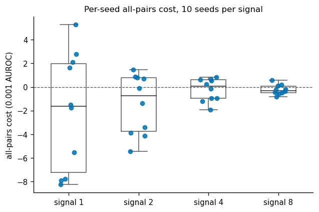

**Purpose.** How big is the cost seed by seed, and does its sign agree across seeds?
**Data.** The all-pairs cost for seeds 1 to 10 at each of signals 1, 2, 4, 8; box shows median and quartiles; points are the ten seeds (horizontal jitter only).
**What it shows.** The spread falls steeply with signal (sd 0.0050, 0.0025, 0.0010, 0.0004). Negative seeds number 6, 6, 5, 7 of 10, so the sign is close to a coin flip at every signal; the means sit below 0 mostly because a few seeds are more negative than the positive ones are positive (signal 1: seeds 2 to 4 near -0.008, seed 6 at +0.005). Ten seeds cannot say whether the center is below 0.
*Index:* Boxplot with individual data points.

### C02 · Mean cost with bootstrap interval
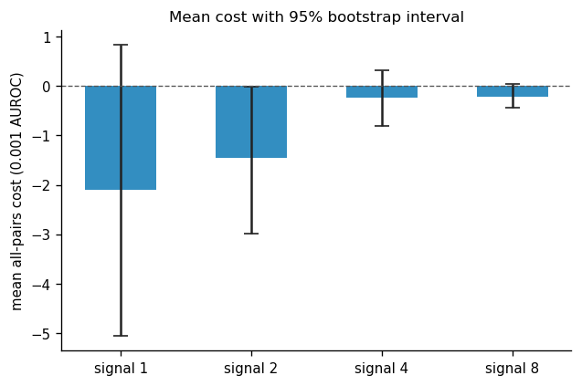

**Purpose.** What is the mean cost per signal, and does its interval clear 0?
**Data.** Mean over seeds 1 to 10 of the cost at each signal; whiskers are the project's 95% percentile bootstrap (10000 resamples).
**What it shows.** Means -0.0021, -0.0015, -0.0002, -0.0002. Three intervals include 0; signal 2's upper end is -0.00001, so it excludes 0 by a hair. Signal 8's upper end is +0.00003 and signal 1's is +0.0008. The line between "just below" and "includes" is a few hundredths of a thousandth of AUROC and should not be read as a difference in kind.
*Index:* Barplot with error bars.

### C03 · Mean cost and interval across signal
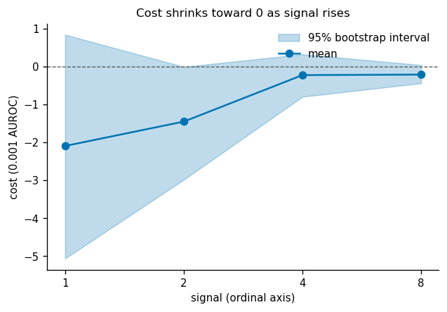

**Purpose.** Does the cost trend toward 0 as signal rises?
**Data.** The same means and bootstrap intervals as C02, joined along signal 1, 2, 4, 8 drawn on an evenly spaced (ordinal) axis.
**What it shows.** The mean and the interval width both shrink with signal: widths 0.0059, 0.0030, 0.0011, 0.0005. The drop from signal 2 to 4 is the largest step in the mean. Joining four points implies a smooth curve that four signals cannot establish, and the even spacing hides that the signals double.
*Index:* Timeseries plot with error bands.

### C04 · Per-seed cost in seed order, one panel per signal
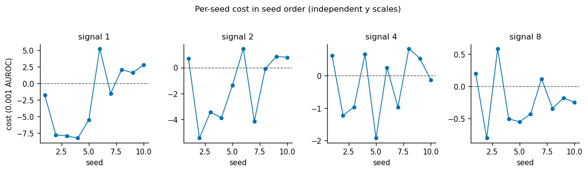

**Purpose.** Is there any ordering or drift in the cost across seeds?
**Data.** Cost for each seed 1 to 10, one panel per signal, each with its own y scale.
**What it shows.** No trend by seed. Seeds are independent draws, so the line has no meaning between points; it is only there to carry the eye. The panels repeat the information of C01 with seed identity kept.
*Index:* Line plots on multiple facets.

### C05 · Per-seed DeLong intervals
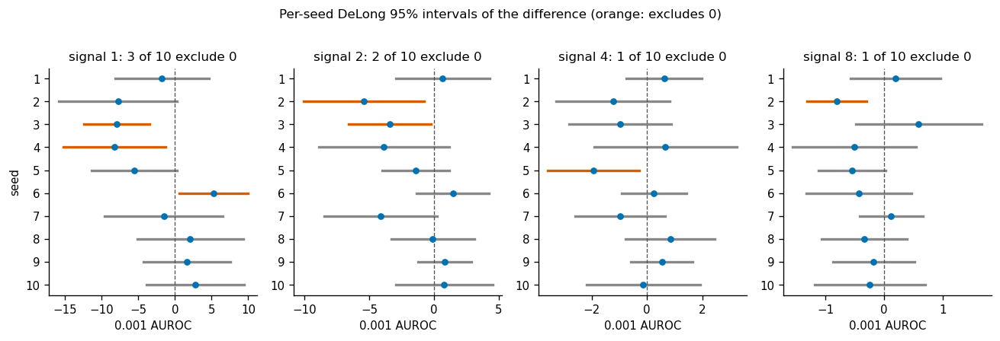

**Purpose.** Within one draw, can the held-out set itself distinguish the two arms?
**Data.** For each seed, the difference AUROC(all pairs) minus AUROC(x3·x4) with its DeLong 95% interval on the 4000 held-out rows; one panel per signal; orange intervals exclude 0.
**What it shows.** 3, 2, 1, 1 of 10 seeds exclude 0 at signals 1, 2, 4, 8. At signal 1 two exclude it below (seeds 3 and 4) and one above (seed 6, +0.0053). With ten 95% intervals per signal one or two exclusions are expected by chance if the true difference were 0, so the counts are close to that baseline. DeLong treats the training as fixed, so it covers held-out sampling only, not seed-to-seed variation in the fit.
*Index:* Conditional means with observations.

### C06 · Bootstrap distribution of the mean cost
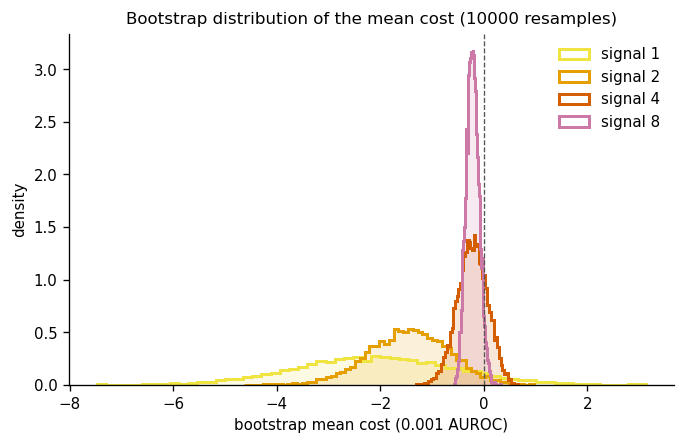

**Purpose.** How much of each signal's distribution of the mean lies on each side of 0?
**Data.** The 10000 sorted bootstrap means that produce the intervals of C02, as a density per signal (60 bins).
**What it shows.** Signal 1 is wide and straddles 0; signal 2 is centered near -0.0015 with a thin right tail past 0; signals 4 and 8 are narrow and centered a little below 0, with 8 the tightest. It shows that signal 2's interval touches 0 because of the tail, not because of a different center. The bootstrap of ten values has a coarse support, so the tails are rough.
*Index:* Density plot of several variables.

### C07 · Mean AUROC by arm
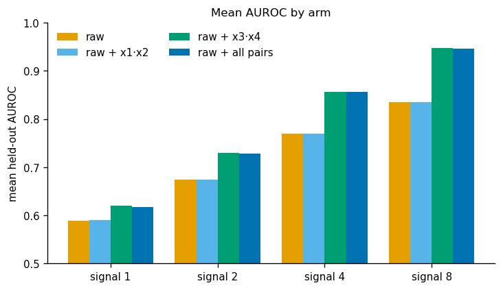

**Purpose.** Where does the all-pairs arm sit among the four arms?
**Data.** Mean held-out AUROC over seeds 1 to 10 for each of the four arms at each signal; y axis starts at 0.5.
**What it shows.** The all-pairs bar is level with the x3·x4 bar at every signal and both are well above raw and raw + x1·x2, which are level with each other. The bar scale cannot show the cost itself (it is under 0.0025 against bars that differ by 0.03 to 0.11), so this view frames the cost but cannot test it.
*Index:* Grouped barplots.

### C08 · Gain over raw, x3·x4 against all pairs
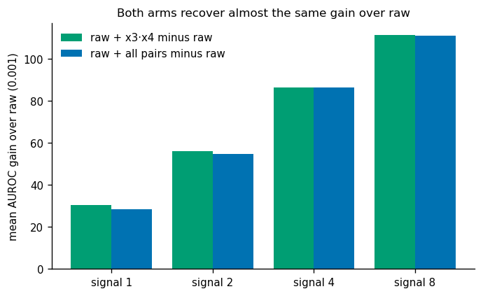

**Purpose.** How much of the x3·x4 gain does the all-pairs arm keep?
**Data.** Mean over seeds of AUROC(arm) minus AUROC(raw): raw + x3·x4 gives 0.0305, 0.0562, 0.0864, 0.1113; raw + all pairs gives 0.0284, 0.0547, 0.0862, 0.1111, at signals 1, 2, 4, 8.
**What it shows.** The all-pairs arm keeps 93%, 97%, 99.7%, 99.8% of the gain. The shortfall is the cost, shown on the gain scale. The percentage is a ratio of means from ten seeds and carries the cost's uncertainty.
*Index:* Grouped barplots.

### C09 · Each seed's cost across signals
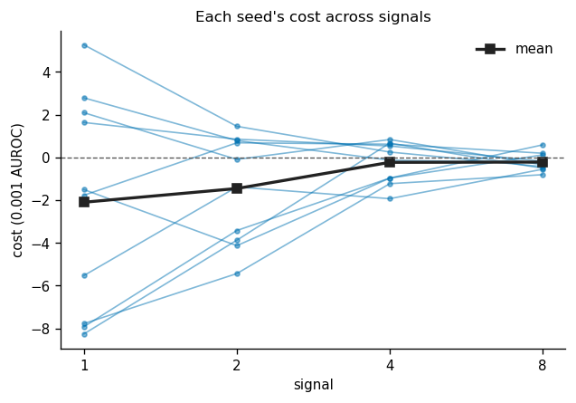

**Purpose.** Does a seed that is costly at one signal stay costly at the next?
**Data.** One path per seed joining its cost at signals 1, 2, 4, 8, with the mean in black.
**What it shows.** Paths fan out at low signal and collapse toward 0 at high signal. At signals 1 and 2 the same seeds are negative (seeds 2 to 4); at signal 8 the order appears shuffled. The same seed shares its draw across signals (see C10), so these are not independent paths.
*Index:* Scatter plot with point paths on hover and search box.

### C10 · Seed-to-seed agreement of the cost between signals
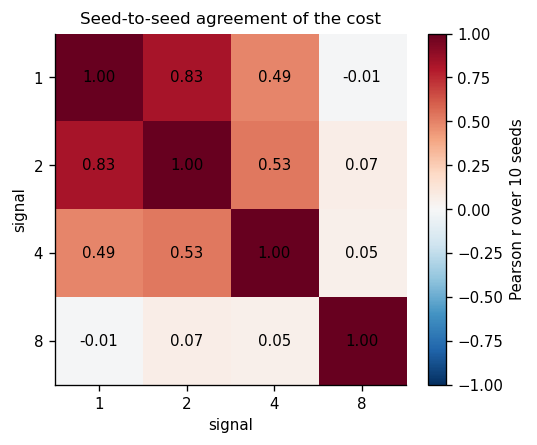

**Purpose.** Are the four signals' costs independent estimates?
**Data.** Pearson correlation across seeds 1 to 10 between the cost vectors of each pair of signals.
**What it shows.** Signals 1 and 2 agree (r = 0.83), 2 and 4 and 1 and 4 moderately (0.53, 0.49), and signal 8 with nothing (-0.01, 0.07, 0.05). With ten seeds a correlation of 0.5 has a wide interval. The pattern says the low-signal costs share something seed-specific (the same x draw), which means the four intervals are not four independent confirmations.
*Index:* Periodic Table (tile grid with labels).

### C11 · AUROC pairs per seed
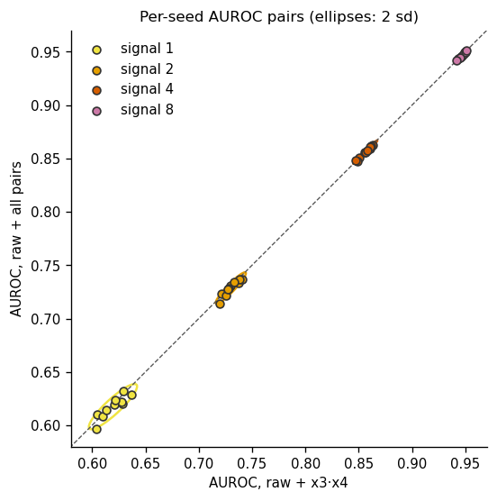

**Purpose.** Do the two arms rank seeds the same way, and how far from the diagonal do they fall?
**Data.** Each point is one seed: AUROC(x3·x4) on x, AUROC(all pairs) on y, colored by signal; ellipse is 2 sd of the ten points; dashed line is equality.
**What it shows.** Points lie on the diagonal at every signal; the cost is a displacement far smaller than the between-seed spread of AUROC (about 0.01 at signal 1). The tight cloud is partly built in: both arms see the same draw, so their AUROCs move together. At this scale the plot cannot resolve the cost.
*Index:* Confidence Interval Ellipses.

### C12 · Cost against its own term, with fit (coupling check)
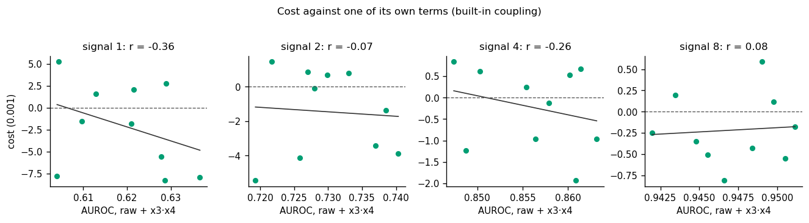

**Purpose.** Does the cost depend on how good the draw is for the x3·x4 arm?
**Data.** Per signal, cost against AUROC(x3·x4) over the ten seeds, with a least-squares line; r shown.
**What it shows.** r = -0.36, -0.07, -0.26, +0.08 at signals 1, 2, 4, 8. This is not a finding: AUROC(x3·x4) is the subtracted term of the cost, so a draw-level error in it enters the cost with a minus sign and pushes r negative by construction. Ten points also leave r near 0 indistinguishable from any of these values.
*Index:* Anscombe's quartet.

### C13 · Held-out scores of the two arms, one draw
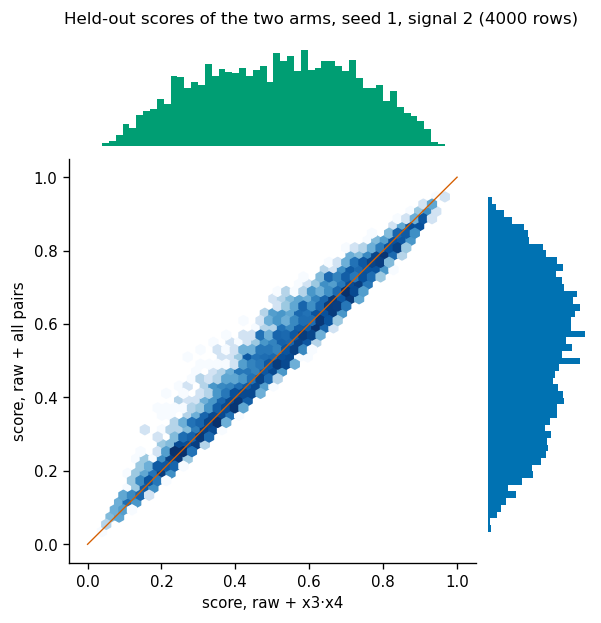

**Purpose.** At the row level, are the two arms making the same predictions?
**Data.** All 4000 held-out rows of seed 1 at signal 2: score of raw + x3·x4 on x, raw + all pairs on y; hexbin counts on a log scale, with each score's marginal histogram.
**What it shows.** Rows lie along the diagonal (score correlation 0.939, 0.979, 0.996, 0.998 at signals 1, 2, 4, 8 for the same seed), with a visible band of width, mostly in the middle. Marginals are nearly alike. Seed 1 is one draw and not the seed with the largest cost.
*Index:* Hexbin plot with marginal distributions.

### C14 · Row-level score change from the extra columns
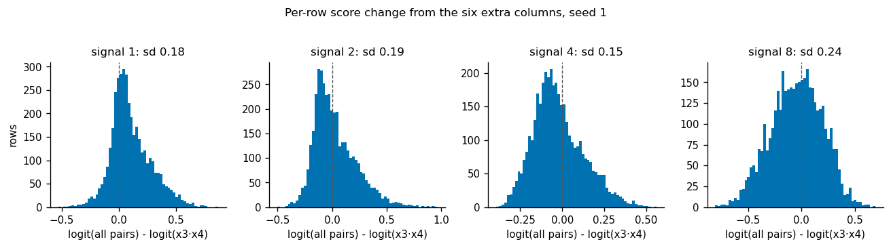

**Purpose.** How much do the six extra columns move individual predictions?
**Data.** For seed 1 at each signal, histogram over the 4000 held-out rows of logit(all-pairs score) minus logit(x3·x4 score).
**What it shows.** Row-level changes have sd 0.18, 0.19, 0.15, 0.24 in logit units: individual predictions move by amounts that dwarf the AUROC difference, yet the ranking quality hardly changes. The shifts are mostly ranking-neutral. The spread is largest at signal 8, where the cost is smallest, so the size of row-level shifts does not track the cost.
*Index:* Facetting histograms by subsets of data.

### C15 · Row-level change split by label
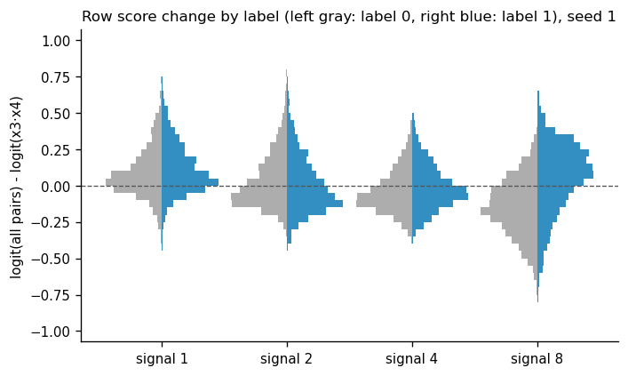

**Purpose.** Do the extra columns move the two classes in opposite directions (which would change AUROC) or together?
**Data.** The row-level change of C14 for seed 1, left half rows with label 0, right half rows with label 1, 40 bins each, at each signal.
**What it shows.** At signal 8 the label-1 half sits above 0 and the label-0 half below, the separation that would raise AUROC; at signals 1, 2, 4 the label-1 half sits only slightly higher than the label-0 half. Within one seed the sign of this separation, not the size of the shifts, is what the cost reflects, and a single seed cannot tell whether the separation is consistently small.
*Index:* Grouped violinplots with split violins.

### C16 · Row-level change along the true score (hexbin, 2D histogram)
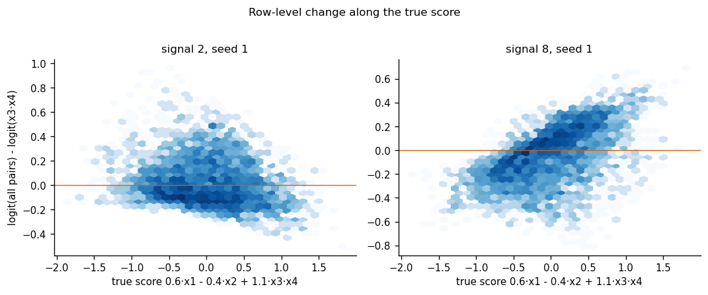

**Purpose.** Do the extra columns tilt the score along the true direction?
**Data.** Seed 1, signals 2 and 8: the row-level change of C14 against the true score 0.6·x1 - 0.4·x2 + 1.1·x3·x4 on the 4000 held-out rows; log-count hexbins.
**What it shows.** At signal 8 the change rises with the true score (the all-pairs arm is a little steeper along the truth); at signal 2 it falls slightly. Hexbin of a difference against a quantity both scores depend on can show a slope from different fitted scales alone, so this is a description of seed 1, not evidence about the arms.
*Index:* Plot a Basic 2D Histogram using Matplotlib (hexbin variant).

## What can be inferred, and what cannot

- Can: the all-pairs arm recovers nearly all of the x3·x4 gain at every signal (93% to 99.8%), so a model that is not told the pair loses at most about 0.002 AUROC here.
- Can: the cost is small relative to its own spread, and both shrink with signal (sd 0.0050 to 0.0004).
- Cannot: say the cost is truly negative at signal 2. Its interval's upper end is -0.00001; the same ten seeds also have 4 of 10 seeds at or above 0, and signal 1 and 2 costs are correlated (r = 0.83), so they are not two independent looks.
- Cannot: tell the signal pattern from a smooth trend; four signals only.
- Not a finding: the correlation of the cost with the x3·x4 arm's AUROC (C12) and any slope of the row-level change against the true score (C16), which are built into how the quantities are defined.
- Cannot: generalize the row-level views (C13 to C16) beyond seed 1.

## Open questions for this line

- Would 30 or 100 seeds settle whether signal 2's cost is below 0, or does it stay on the edge of its interval?
- Does the cost grow with fewer training rows, where ten extra columns are harder to fit than one?
- Is the signal 1 to 2 agreement of costs (r = 0.83) a shared-draw effect, and would drawing fresh data per signal remove it?
- Does the cost change with a different number of noise products (all pairs are six; what about 15 or 45 columns)?
- Do the row-level shifts that split by label at signal 8 (C15) have a consistent sign across seeds?

## Index accounting

| Chart type | Result |
|---|---|
| bar | not drawn: C02 carries the same values with an interval |
| bar with error bars | drawn as C02 |
| bar with n | not drawn: n is 10 everywhere |
| bar with value labels | not drawn: values are in the text; C02 already has the interval |
| bar, variable width | not drawn: no weighting variable |
| grouped bar | drawn as C07, C08 |
| polar bar | not drawn: no cyclic variable |
| box | not drawn: C01 is the same with points |
| box with points | drawn as C01 |
| density | not drawn: C06 draws several |
| density, several groups | drawn as C06 |
| grouped box | not drawn: C01 covers it; arms-by-signal AUROC is in C07 |
| histogram | not drawn: C14 is the faceted form |
| histogram, faceted | drawn as C14 |
| means with observations | drawn as C05 (per-seed estimate with its own interval) |
| split violin | drawn as C15 |
| stacked histogram, log scale | not drawn: no stacked counts |
| scatter heatmap | not drawn: C10 is the tile form |
| tile grid with labels | drawn as C10 |
| Andrews curves | not drawn: no multivariate profiles per group |
| area | not drawn: signal has four values, no continuous series |
| area, faceted | not drawn: same |
| line with band | drawn as C03 |
| line, faceted | drawn as C04 |
| line, segments | not drawn: no forecast or segmented series |
| mosaic | not drawn: no counts in two categorical splits |
| stacked area | not drawn: no whole to partition |
| stacked bar | not drawn: no whole to partition |
| 2D density contour | not drawn: C13 and C16 show the same pairs as hexbins |
| 2D histogram | drawn as C16 (hexbin variant) |
| bubble | not drawn: no third quantity worth encoding as size |
| connected scatter (paths) | drawn as C09 |
| faceted scatter with fit | drawn as C12 (a coupling check, not a finding) |
| hexbin with marginals | drawn as C13 |
| joint density | not drawn: C13 shows the same rows |
| joint histogram | not drawn: C13 shows the same rows |
| scatter with CI ellipses | drawn as C11 |
| scatter, hue and size | not drawn: no extra variables to encode |
| scatter, shapes | not drawn: no extra variables to encode |
| scatter, text markers | not drawn: seed labels would not add information |

16 plots from 16 index entries (40 distinct chart types considered).
