# General report: interaction terms on the toy set

*Prototype, throwaway. Built on 2026-10-01 from the toy's M7 results (`~/wayline-m7/toy/`, read in place) for the owner to react to. Every number below was recomputed from the 160 run summaries and checked against the project's analysis files.*

## Objectives

- **O1** (answered for this model and this set). Does modelling the x3·x4 interaction raise held-out AUROC on the synthetic set, and is it the right term rather than any extra column? Results R1 to R5.
- **O2**, a goal: held-out AUROC of at least 0.82 (measure: `auroc`, up, target 0.82, split `held_out`, `toy.eval`). Reached at signal 4 by the raw + x3·x4 arm on every seed; R6 shows what reaching it does and does not say about O1.

## What is known

- Adding the x3·x4 column to a logistic regression on x1 to x4 raises held-out AUROC by 8.6 points at signal 4 (0.0864, 95% bootstrap interval 0.0829 to 0.0897, ten of ten seeds positive). {res:t36-a1/analysis/ablation/signal-4.json#paired_gain}
- The gain belongs to that product: a wrong product (x1·x2) with the same number of columns adds nothing over raw at any signal, so the margin over it equals the gain. {res:t37-a1/analysis/ablation/signal-8.json#credit_margin}
- The gain holds at every signal tried and grows with it: 3.1, 5.6, 8.6, and 11.1 points at signals 1, 2, 4, and 8, about 2.5 to 3 points per doubling of the signal. {res:t37-a1/analysis/ablation/report.md#Omnibus}
- Giving the model all six products instead of the right one costs about a fifth of a point at most, and less as the signal grows. {res:t44-a1/analysis/ablation/signal-2.json#allpairs_cost}
- With the right column the model sits within a third of a point of the best ranking any model could make, recovering 92% (signal 1) to 99.7% (signal 8) of what the raw model misses. {res:t45-a1/analysis/ablation/signal-1.json#ceiling.means}
- Whether a run clears 0.82 is decided by the signal more than by the term: at signals 1 and 2 no model can reach it, and at signal 8 the raw model reaches it without the term. {res:t37-a1/analysis/ablation/signal-8.json#goal_check.seeds_at_or_above_target}

| signal | paired gain (points) | 95% interval | credit margin | all-pairs cost | Bayes ceiling | left to the ceiling | seeds at or above 0.82 (raw / x1·x2 / x3·x4 / all pairs) |
|---|---|---|---|---|---|---|---|
| 1 | 3.05 | 2.59 to 3.55 | 2.99 | −0.21 (−0.51 to 0.08) | 0.622 | 0.28 | 0 / 0 / 0 / 0 |
| 2 | 5.62 | 5.19 to 6.00 | 5.53 | −0.15 (−0.30 to −0.001) | 0.732 | 0.15 | 0 / 0 / 0 / 0 |
| 4 | 8.64 | 8.29 to 8.97 | 8.62 | −0.02 (−0.08 to 0.03) | 0.857 | 0.09 | 0 / 0 / 10 / 10 |
| 8 | 11.13 | 10.73 to 11.52 | 11.17 | −0.02 (−0.04 to 0.003) | 0.947 | 0.03 | 10 / 10 / 10 / 10 |

*All differences in points (0.01 AUROC); means over ten seeds; intervals are 95% percentile bootstraps over seeds.*

---

## R1. At signal 4, adding x3·x4 raises held-out AUROC by 8.6 points

The raw arm averages 0.770 and the raw + x3·x4 arm 0.856 on the same ten draws. Every seed gains, and every seed's own DeLong interval excludes 0. {res:t36-a1/analysis/ablation/signal-4.json#paired_gain}

### P01 · Each seed's raw and raw + x3·x4 AUROC, joined
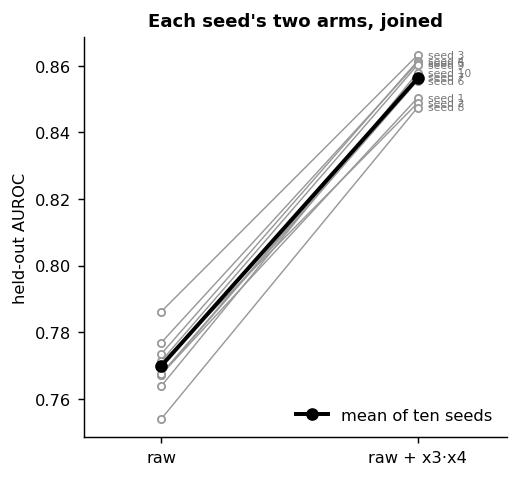
**Purpose.** Show that the gain is not an average hiding losers.
**Data.** Held-out AUROC of the two arms for seeds 1 to 10 at signal 4; one line per seed, the bold line joins the means.
**What it shows.** All ten lines rise, by 7.7 to 9.4 points. The raw arm's seeds spread over 3.2 points (0.754 to 0.786), the new arm's over 1.6 (0.847 to 0.863): the new arm is both better and steadier across draws.
*Index:* Scatter plot with point paths on hover and search box (drawn static).

### P02 · The ten per-seed paired gains at signal 4, with the mean and its interval
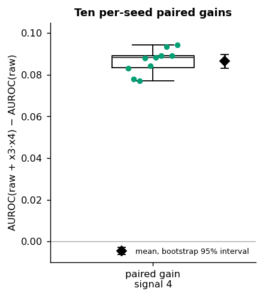
**Purpose.** The headline number with its spread and its uncertainty in one view.
**Data.** The ten per-seed paired gains (AUROC of raw + x3·x4 minus raw); box of the ten, the points themselves, and the mean with its 95% bootstrap interval (10000 resamples over seeds).
**What it shows.** The interval (0.0829 to 0.0897) is narrow and far from 0, and the smallest of the ten gains is 0.077. Ten values make a coarse box: the points carry more than the box does.
*Index:* Boxplot with individual data points; Horizontal boxplot with observations; Basic ggplot2 boxplot.

### P03 · Per-seed paired gain with each seed's DeLong interval
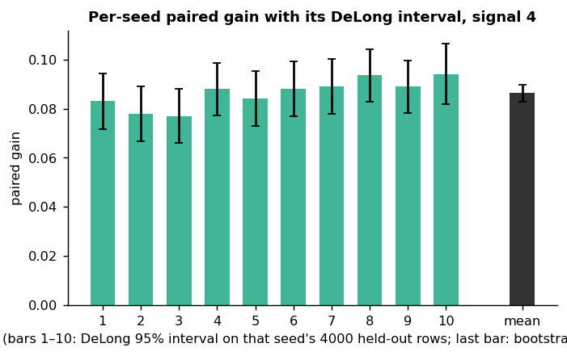
**Purpose.** Check that each seed's gain is resolved on its own held-out rows, not only on average.
**Data.** Per seed, the AUROC difference on its 4000 held-out rows with the 95% DeLong interval; the last bar is the mean with the bootstrap interval over seeds.
**What it shows.** Each seed's interval is about ±1.1 points and its lowest bound is 6.6 points: one seed alone would have settled the question at this signal. The between-seed interval is narrower than any single seed's, as ten draws should make it.
*Index:* Barplot with error bars.

### P04 · Bootstrap distribution of the mean paired gain at signal 4
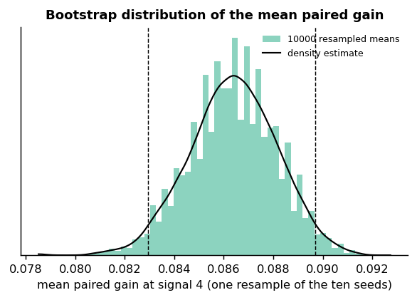
**Purpose.** Show where the interval comes from.
**Data.** The 10000 resampled means (seeds drawn with replacement, `random.Random(0)`, the project's own procedure) as a histogram and a density estimate; dashed lines at the 2.5th and 97.5th percentiles.
**What it shows.** A smooth, symmetric distribution around 0.086. Useful once, to trust the method; it adds nothing per result after that.
*Index:* Histogram with Adjustable Bin Size; Basic density plot with seaborn, and its four variants (shade, horizontal, bandwidth, Density with Some Shade).

### P05 · Held-out scores by class for the two arms, seed 1
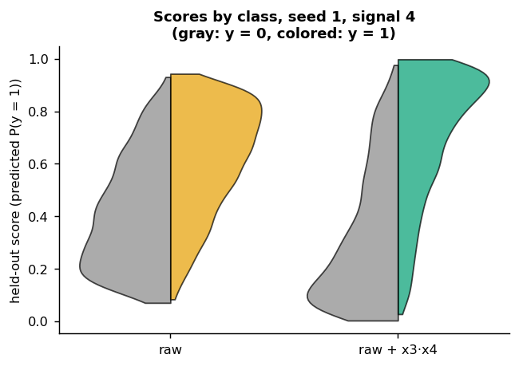
**Purpose.** See what the gain looks like in the predictions themselves.
**Data.** Seed 1, signal 4: the 4000 held-out scores of each arm, split by true label (gray y = 0, colored y = 1).
**What it shows.** With the product column the two classes pull apart: the median score of a negative row drops from 0.38 to 0.26 and of a positive row rises from 0.65 to 0.77. The raw arm's scores are bunched in the middle because it cannot see the product, which carries 44% of the variance of the score the label is drawn from.
*Index:* Grouped violinplots with split violins; Same Color, Different Shade.

### P06 · ROC curves of both arms and the Bayes ceiling, seed 1
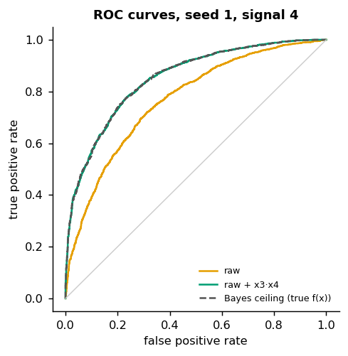
**Purpose.** The standard view of what AUROC summarizes.
**Data.** Seed 1, signal 4: ROC curves from the held-out scores of each arm, and from the true f(x), the best ranking possible.
**What it shows.** The raw + x3·x4 curve lies on the ceiling's curve (AUROC 0.8503 against 0.8507); the raw curve sits below both over the whole range of false-positive rates, so the gain is not confined to one operating point.
*Index:* none; the index has no ROC curve (drawn because it is the natural view of the metric).

### P07 · Mean change in a row's log-odds over the x3, x4 plane
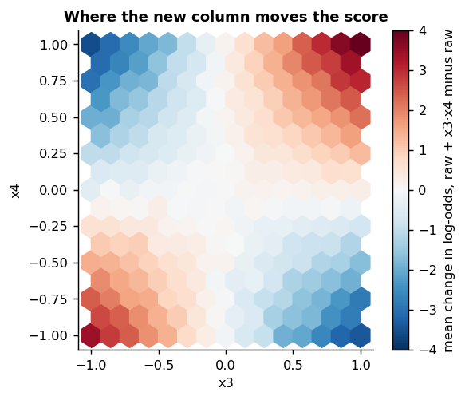
**Purpose.** Find where in the data the new column changes the prediction.
**Data.** Seed 1, signal 4: each held-out row's log-odds under raw + x3·x4 minus under raw, averaged in hexagonal bins over (x3, x4).
**What it shows.** A saddle: scores rise where x3·x4 is positive (mean +1.77 log-odds where x3·x4 > 0.25) and fall where it is negative (mean −1.76 where x3·x4 < −0.25), with no change near the axes. The gain comes exactly from the region the planted term governs. This is the most explanatory plot of R1.
*Index:* Hexbin plot with marginal distributions (marginals left out: x3 and x4 are uniform); Plot a Basic 2D Histogram using Matplotlib.

### P08 · Each held-out row's score under both arms, with marginals per class
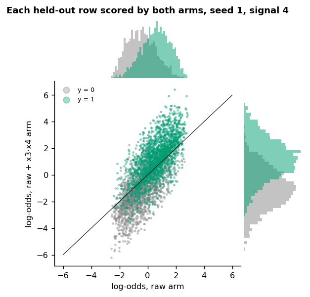
**Purpose.** Show how much the new column reorders the rows.
**Data.** Seed 1, signal 4: per held-out row, log-odds under raw (x) and under raw + x3·x4 (y), colored by true label, with each axis's histogram per class.
**What it shows.** The two scores agree only loosely (Spearman 0.76), and 40% of rows move by more than one unit of log-odds. Positive rows move up and negative rows down, which is the separation P05 shows, seen row by row.
*Index:* Joint and marginal histograms.

---

## R2. The gain belongs to x3·x4, not to an extra column

A wrong product column (x1·x2) gives the model the same five columns, yet its AUROC matches raw at every signal; the margin of the right product over it is the full paired gain. {res:t37-a1/analysis/ablation/signal-4.json#credit_margin} {res:t44-a1/analysis/ablation/signal-8.json#wrong_pair_vs_raw}

### P09 · Mean AUROC of the four arms at each signal
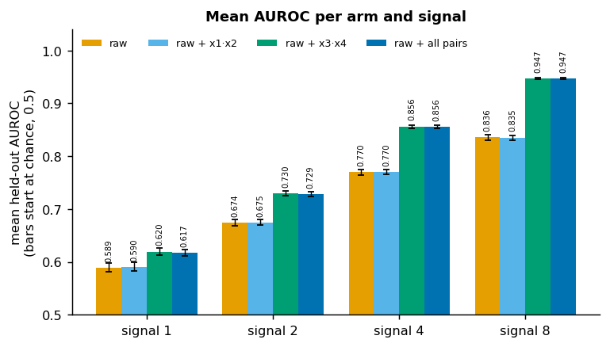
**Purpose.** Compare all four arms at once.
**Data.** Mean held-out AUROC over ten seeds per arm and signal, bars from chance (0.5), error bars the 95% bootstrap interval of the mean, values on the bars.
**What it shows.** The arms fall into two pairs at every signal: raw and raw + x1·x2 together (0.770 and 0.770 at signal 4), raw + x3·x4 and raw + all pairs together (0.856 and 0.856). What matters is whether the model can see x3·x4, not how many columns it has.
*Index:* Grouped barplots; Grouped Bar Chart with xOffset and overlapping bars; A Bar Plot With 2 Variables; Barplot with error bars; Bar Chart with Labels based on Measured Luminance.

### P10 · Per-seed paired gain against credit margin, every signal
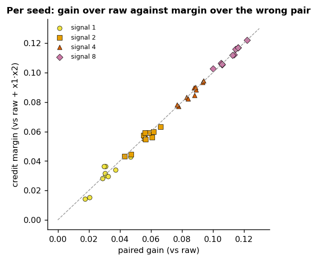
**Purpose.** Ask whether beating the wrong pair is the same thing as beating raw.
**Data.** Per seed and signal (40 points): the paired gain (x) against the credit margin (y); dashed line y = x.
**What it shows.** Every point lies on the line: the margin over the wrong pair is the gain over raw, seed by seed. The wrong column leaves raw's predictions where they were.
*Index:* Scatterplot with multiple semantics; The Shapes of a Scatter Plot; Using Letters as Shapes.

### P11 · What the wrong product column adds over raw, per seed and signal
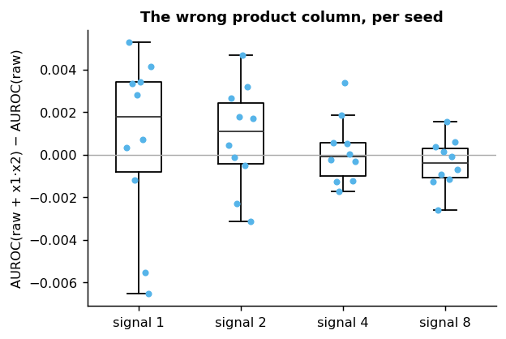
**Purpose.** Measure the capacity effect of an extra column directly.
**Data.** Per seed, AUROC of raw + x1·x2 minus raw, one box per signal with the ten points.
**What it shows.** Centered on 0 at every signal, per-seed values between −0.65 and 0.53 points; the 95% intervals all include 0 (signal 1: −0.18 to 0.29 points; signal 8: −0.11 to 0.02). An unused column neither helps nor hurts a model fitted on 16000 rows.
*Index:* Grouped boxplots; Boxplot with individual data points.

---

## R3. The gain holds at every signal tried and grows with it

At signals 1, 2, 4, and 8 every seed gains and every interval lies above 0. Each verdict is uncorrected and the omnibus statement is their conjunction. {res:t37-a1/analysis/ablation/report.md#Omnibus}

### P12 · Mean paired gain and credit margin across signals with bootstrap bands
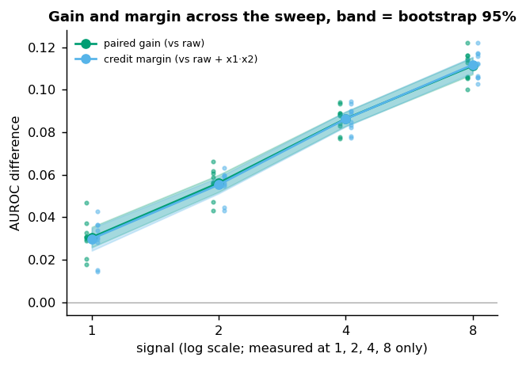
**Purpose.** The sweep in one line.
**Data.** Mean over seeds of the paired gain and of the credit margin at each signal (log scale), shaded 95% bootstrap band, the seeds as dots.
**What it shows.** The gain grows by 2.6, 3.0, and 2.5 points per doubling of the signal: close to linear in the signal's logarithm over 1 to 8. Only four signals were run, so the line between them is a guide, not a measurement. The two curves coincide (R2).
*Index:* Timeseries plot with error bands.

### P13 · Each arm's AUROC across signals, one panel per arm
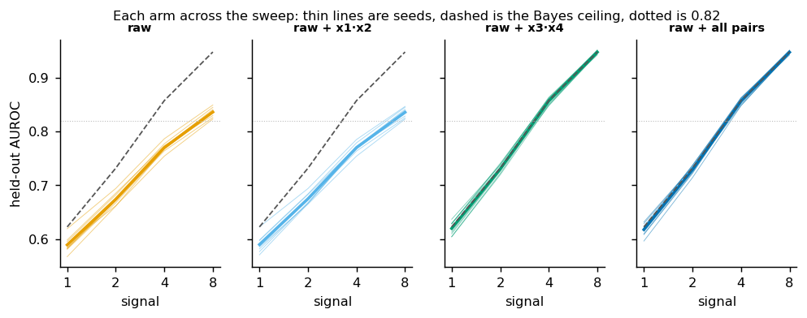
**Purpose.** See each arm's own trajectory, seed by seed, against the ceiling and the 0.82 line.
**Data.** Per arm, the ten seeds' AUROC across signals (thin), their mean (bold), the mean Bayes ceiling (dashed), 0.82 (dotted).
**What it shows.** The two arms with x3·x4 run on the ceiling at every signal; the two without it run below it by a gap that widens from 3 to 11 points. Seeds do not keep their order across signals (the rank correlation of raw's seeds between signals 1 and 8 is 0.33): a seed's rows are the same at every signal, but its labels change with the signal.
*Index:* Line plots on multiple facets; Weather Forecast.

### P14 · Histograms of the ten per-seed gains, one per signal
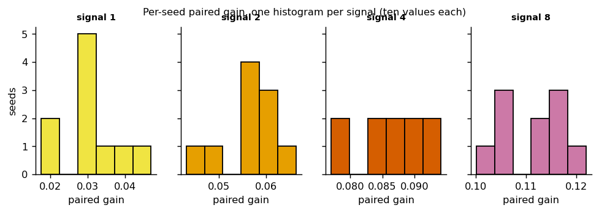
**Purpose.** The shape of each signal's ten gains.
**Data.** Per signal, a six-bin histogram of the ten per-seed paired gains.
**What it shows.** Little: ten values give two or three seeds per bin, and P16 shows the same values without binning. Weak at this sample size.
*Index:* Facetting histograms by subsets of data.

### P15 · Density of the per-seed gains per signal
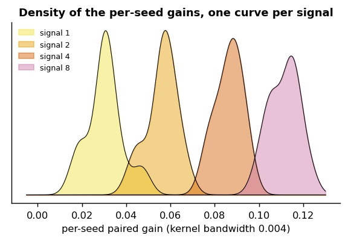
**Purpose.** Compare the four signals' spreads as smooth curves.
**Data.** A Gaussian kernel density (bandwidth 0.004) of each signal's ten per-seed gains.
**What it shows.** Four separated humps of similar width (a seed-to-seed standard deviation of 0.6 to 0.8 points at every signal). The shape inside each hump is mostly the kernel, not the data; weak at ten values.
*Index:* Density plot of several variables.

### P16 · Mean paired gain with every seed's value, per signal
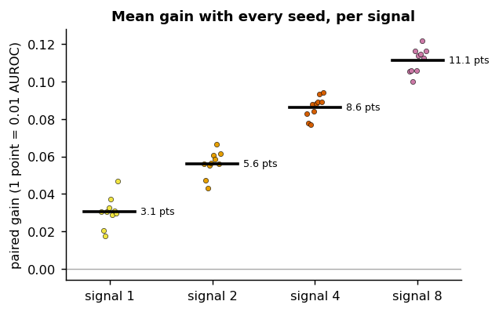
**Purpose.** The sweep's numbers, with every seed visible.
**Data.** Per signal, the ten per-seed paired gains and their mean, labeled in points.
**What it shows.** 3.1, 5.6, 8.6, and 11.1 points; no seed at any signal falls near 0. The plainest view of R3, and the one a reader checks first. The reference that motivated the question reports a gain of "several points" on every signal tried, with no number; these gains are of that order from signal 2 up, and the comparison carries no verdict. {res:t42-a1/analysis/ablation/report.md#Omnibus}
*Index:* Conditional means with observations.

### P17 · Each seed's two AUROCs, an ellipse per signal
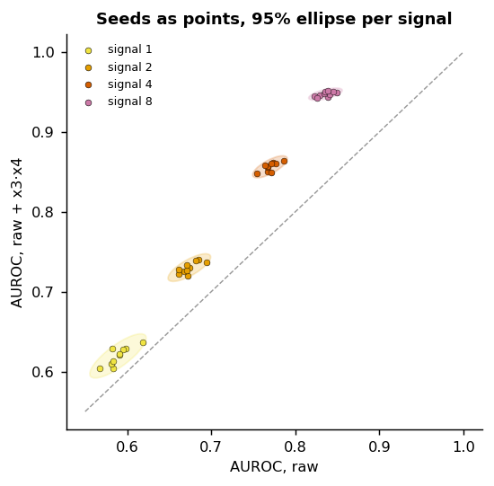
**Purpose.** Paired view across the sweep: is every seed above the line, and how do the arms co-vary?
**Data.** Per seed and signal, raw AUROC (x) against raw + x3·x4 AUROC (y); a 95% normal ellipse per signal; dashed y = x.
**What it shows.** Four clusters, all above the diagonal, none touching it. Within a signal the two arms co-vary (correlation 0.81, 0.76, 0.73, 0.62): a draw that is hard for one arm is hard for the other, which is why pairing by seed narrows the intervals.
*Index:* Confidence Interval Ellipses.

### P18 · Paired gain against the raw arm's AUROC per seed, one panel per signal
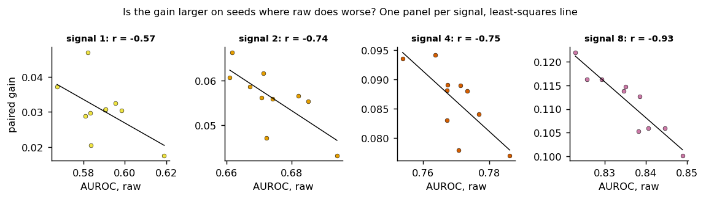
**Purpose.** Ask whether the gain is larger on draws that are harder for raw.
**Data.** Per signal, the ten seeds' raw AUROC (x) against their paired gain (y), with a least-squares line.
**What it shows.** A negative slope at every signal (r = −0.57, −0.74, −0.75, −0.93), but it is an artifact: the gain is the new arm's AUROC minus raw's, so it contains raw with a minus sign, and raw varies more across seeds than the new arm does (standard deviation 0.008 against 0.003 at signal 8). Against an independent measure of how hard a draw is, its Bayes ceiling, the gain does not correlate (r = 0.06, −0.07, −0.04, −0.34). **No finding here**; the plot is kept to show the trap.
*Index:* Anscombe’s quartet; Anscombe’s Quartet.

### P19 · The paired gain drawn as the area between the arms' mean AUROC
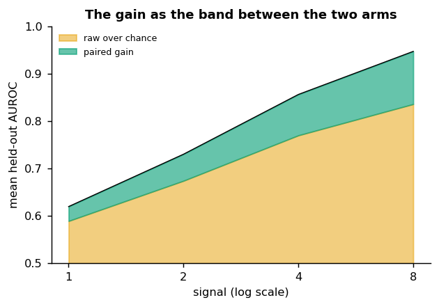
**Purpose.** The gain as a visible band that widens with the signal.
**Data.** Mean AUROC of raw (top of the orange area, from chance at 0.5) and of raw + x3·x4 (top of the green band) at each signal, log scale.
**What it shows.** The green band widens from 3 to 11 points while both arms rise. Same content as P12 and P13; an area suggests a continuum between the four measured signals that was not measured.
*Index:* Basic Area Chart; Improved Area Chart; Area chart with base R; Coal Production; Area Chart and Faceting.

---

## R4. Not knowing the pair costs almost nothing

Given all six products, the model finds the right one: the cost against being given only x3·x4 is under a quarter point at every signal and shrinks as the signal grows. Its interval lies just below 0 at signal 2 and includes 0 elsewhere. {res:t44-a1/analysis/ablation/signal-2.json#allpairs_cost} {res:t44-a1/analysis/ablation/signal-1.json#allpairs_cost} *This is the line of work the current report explores in full.*

### P20 · Mean all-pairs cost per signal with its interval
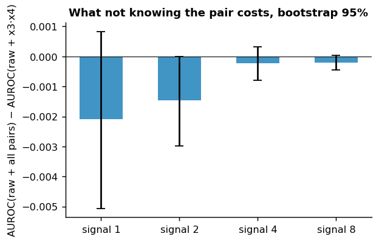
**Purpose.** The cost per signal at a glance.
**Data.** Mean over seeds of AUROC(raw + all pairs) minus AUROC(raw + x3·x4), with the 95% bootstrap interval.
**What it shows.** −0.21, −0.15, −0.02, and −0.02 points. The cost is largest where the signal is weakest, consistent with five extra fitted columns adding noise when the signal is weak, but it stays a fraction of a point.
*Index:* Barplot with error bars.

---

## R5. With x3·x4 the model sits within a third of a point of the Bayes ceiling

The label is a noisy logistic of 0.6·x1 − 0.4·x2 + 1.1·x3·x4, so ranking rows by that score is the best any model can do; its AUROC on each seed's held-out rows is the ceiling. {res:t45-a1/analysis/ablation/signal-4.json#ceiling.means}

### P21 · The Bayes ceiling split into raw, the paired gain, and what is left
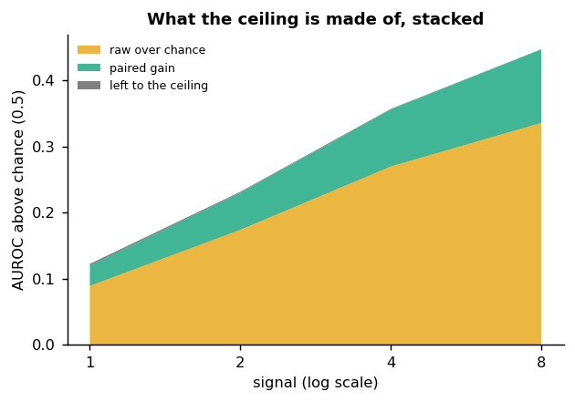
**Purpose.** Show how the reachable AUROC divides between what raw gets, what the product adds, and what nobody gets.
**Data.** Mean over seeds at each signal: raw AUROC above chance, the paired gain, and the ceiling minus raw + x3·x4, stacked.
**What it shows.** The gray layer is invisible at this scale: with the product, almost nothing is left. The product recovers 91.5%, 97.4%, 99.0%, and 99.7% of what raw misses at signals 1, 2, 4, and 8.
*Index:* Stacked area chart with R.

### P22 · The Bayes ceiling split per signal, as stacked bars
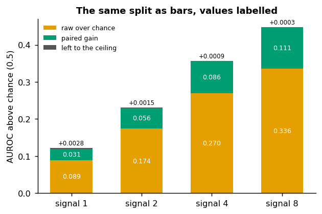
**Purpose.** The same split, readable as numbers.
**Data.** As P21, as bars with each part's value.
**What it shows.** At signal 8: 0.336 above chance from raw, 0.111 from the product, 0.0003 left. The bars carry the numbers P21 cannot, and need no continuum between signals; of the two, this one.
*Index:* Stacked Bar Chart; Reorder stacked bar segments.

### P23 · Each seed's distance to the ceiling, stacked by signal, log scale
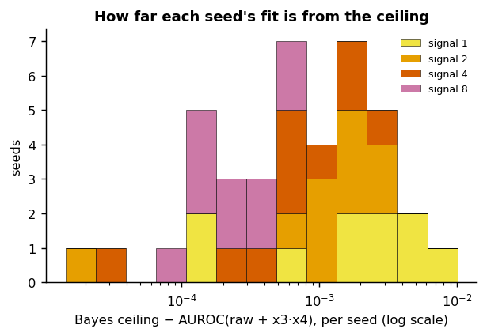
**Purpose.** See the small gap at all, since a linear axis flattens it to 0.
**Data.** Per seed and signal, the ceiling minus raw + x3·x4's AUROC (40 values), a histogram on a log axis, stacked by signal.
**What it shows.** Gaps run from 0.00002 to 0.0084, every one positive (no fit beats its ceiling, a sanity check that passes). They shrink with the signal: signal 1's sit near 0.003, signal 8's near 0.0003.
*Index:* Stacked histogram on a log scale.

### P24 · Each seed's fit against its ceiling, sized by the paired gain
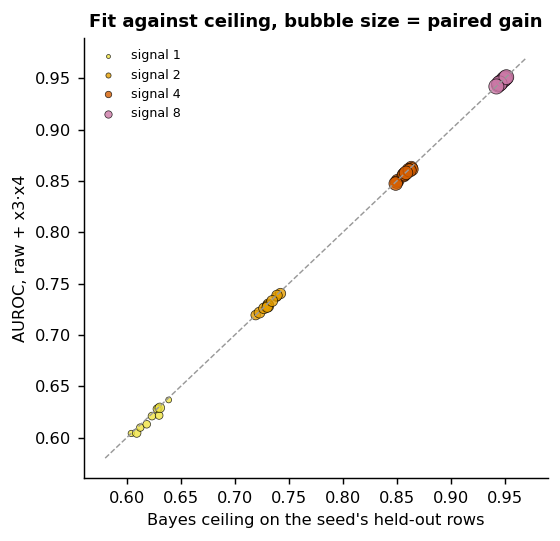
**Purpose.** Fit, ceiling, and gain per seed in one view.
**Data.** Per seed and signal, the Bayes ceiling (x) against raw + x3·x4's AUROC (y); bubble area proportional to the paired gain; dashed y = x.
**What it shows.** Every bubble sits on the diagonal, and bubbles grow along it: the higher the signal, the more the product adds and the closer the fit gets. The size channel is hard to read; P21 and P22 say it more plainly.
*Index:* Oh My Bubbles.

---

## R6. Reaching 0.82 depends on the signal more than on the term

The 0.82 target is reached by both arms with x3·x4 at signal 4 and by every arm at signal 8; at signals 1 and 2 nothing reaches it, though the paired gain holds there. {res:t37-a1/analysis/ablation/signal-8.json#goal_check.seeds_at_or_above_target}

### P25 · Seeds reaching 0.82 and the mean AUROC, arm by signal
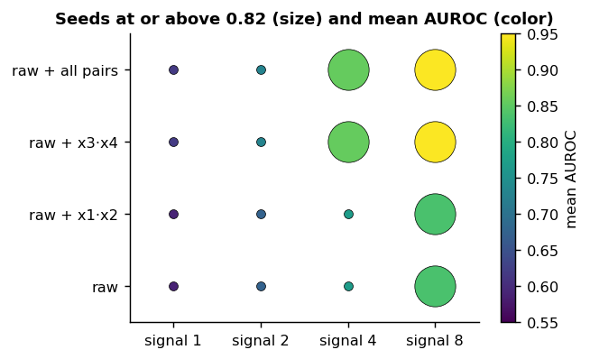
**Purpose.** The goal's whole grid in one view.
**Data.** Per arm and signal, the number of seeds at or above 0.82 (marker size) and the mean AUROC (color).
**What it shows.** An L-shaped pattern: the target falls at signal 4 only to the arms with x3·x4, and at signal 8 to all four.
*Index:* Scatterplot heatmap.

### P26 · Seeds reaching 0.82 per arm and signal, as labeled tiles
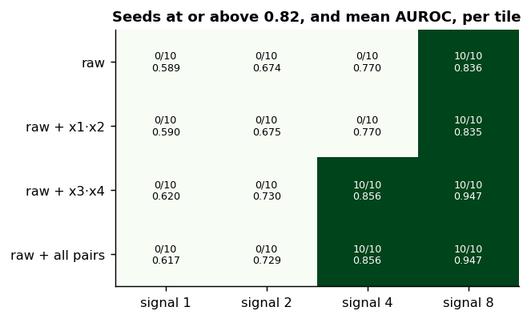
**Purpose.** The same grid with exact numbers.
**Data.** As P25, each tile labeled with seeds at or above 0.82 out of ten and the mean AUROC.
**What it shows.** The raw arm reaches 0.82 on all ten seeds at signal 8 (mean 0.836) without the term, and the raw + x3·x4 arm misses it on all ten at signal 2 (mean 0.730) while gaining 5.6 points. Clearer than P25 for the same data.
*Index:* Periodic Table.

### P27 · Every seed's AUROC per arm and signal, with the 0.82 line
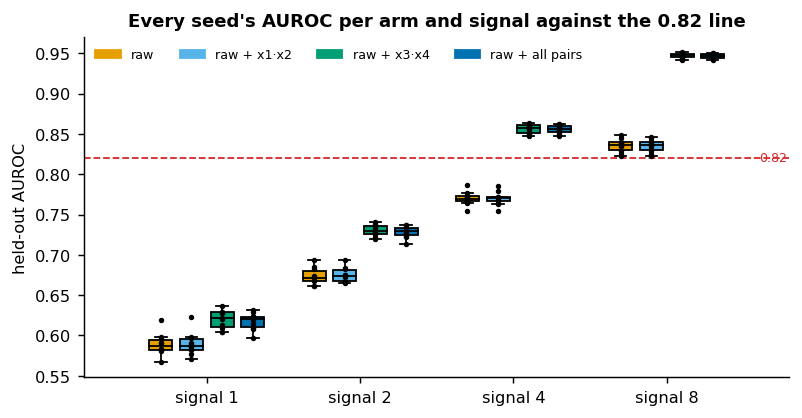
**Purpose.** See how far each cell sits from the line, not only whether it crosses.
**Data.** Per arm and signal, a box of the ten seeds' AUROC with the points, and the 0.82 line.
**What it shows.** At signals 1 and 2 every arm is far below 0.82, and so is the ceiling (at most 0.639 and 0.742 on any seed): no model could reach the target there. At signal 4 the line falls between the two pairs of arms. The target separates the arms only at signal 4, the signal it was set for.
*Index:* Grouped boxplots; Basic ggplot2 boxplot.

---

## What can be inferred, and what cannot

- **Can.** For a logistic regression on this generator, the planted product term accounts for the gain, all of it, at every signal tried; the model recovers nearly all of what is recoverable once it can see that column, whether it is given the one product or all six.
- **Can.** Clearing or missing 0.82 is no evidence for or against the term: the target is out of reach at signals 1 and 2 for any model, and reached without the term at signal 8.
- **Cannot.** Anything about models that can learn products themselves (trees, networks), about real data, or about signals between and beyond the four measured. The four signals are uncorrected, separate verdicts.
- **Cannot.** That the gain depends on how hard a draw is (P18 is an artifact).

## Open questions

- Does the gain survive a model class that can form products on its own, or does it then shrink toward 0?
- Where does the gain stop growing with the signal? Raw's own gap to the ceiling must eventually close as both approach 1.
- With fewer training rows, do six products cost more than one (the current report's line)?

## Index accounting

27 plots: 26 from the index and one outside it (P06, ROC). They draw on 45 of the index's 75 entries (57 of the 75 are chart types; 18 are styling tutorials, cheatsheets, maps, art, or interactive only).

| chart type (index entries) | used | why not |
|---|---|---|
| bar, plain (5 entries) | no | each plain bar here duplicates the grouped bar (P09) or the bar with error bars (P03, P20) |
| bar, variable width | no | every group has ten seeds; width would carry nothing |
| bar with n | no | n is ten everywhere |
| polar bar | no | angle has no meaning for signals or arms |
| mosaic | no | needs two categorical variables; AUROC is threshold-free, and a confusion table needs a threshold the research never set |
| Andrews curves | no | rows of x1 to x4 as curves cannot show a product of two of them |
| 2D density contour, joint density | no | same held-out rows as P07 and P08, nothing new |

## Not in this report

Of the project's 52 findings, 43 are merged into the six results above (many say the same thing from different runs). The other 9 are about the code (`toy.analyze`'s exit codes, its goal-artifact path), the run's checks (reproduction of the refactor, the held-out discipline, cell counts), and compute (645 GPU seconds); those belong to Methods or to the run's own account, not to a report on the research.
