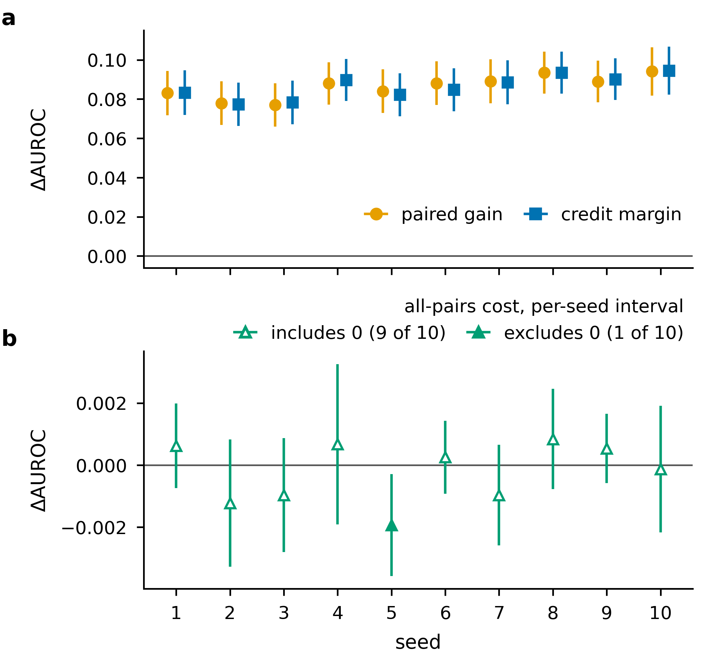
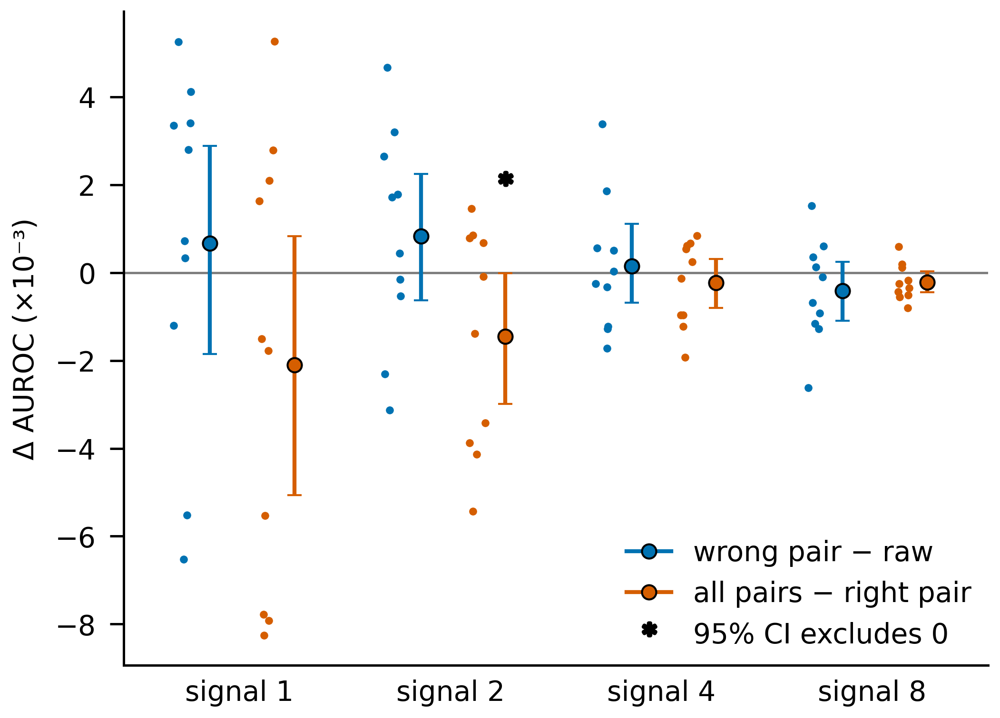

# A pre-specified paired ablation of a planted interaction term: held-out AUROC gain, credit and distance from the Bayes ceiling at four signal strengths

## Authors

Author names, affiliations and the corresponding address are to be added by the owner.

## Abstract

We report a pre-specified paired ablation of an interaction term on a synthetic two-class set whose label is built from the product x3·x4. Four logistic-regression arms were fitted on shared draws for ten seeds at signal strengths 1, 2, 4 and 8. Adding x3·x4 raised held-out AUROC by a mean of 0.0305, 0.0562, 0.0864 and 0.1113, with every 95% bootstrap interval above 0. {res:t37-a1/analysis/ablation/signal-1.json#paired_gain} {res:t37-a1/analysis/ablation/signal-2.json#paired_gain} {res:t36-a1/analysis/ablation/signal-4.json#paired_gain} {res:t37-a1/analysis/ablation/signal-8.json#paired_gain} The x3·x4 arm's margin over a wrong-pair control, x1·x2, also had an interval above 0 at every signal. {res:t37-a1/analysis/ablation/signal-1.json#credit_margin} {res:t37-a1/analysis/ablation/signal-2.json#credit_margin} {res:t36-a1/analysis/ablation/signal-4.json#credit_margin} {res:t37-a1/analysis/ablation/signal-8.json#credit_margin} The arm's mean shortfall from the Bayes ceiling fell from 0.0028 at signal 1 to 0.0003 at signal 8. {res:t37-a1/analysis/ablation/signal-1.json#ceiling.means} {res:t37-a1/analysis/ablation/signal-2.json#ceiling.means} {res:t36-a1/analysis/ablation/signal-4.json#ceiling.means} {res:t37-a1/analysis/ablation/signal-8.json#ceiling.means} Neither the rule that withholds credit nor the rule that declares a signal failed was triggered, so the study does not show that the protocol can detect a missing or misattributed effect. {res:t37-a1/analysis/ablation/signal-1.json#credit_margin} {res:t37-a1/analysis/ablation/signal-2.json#credit_margin} {res:t36-a1/analysis/ablation/signal-4.json#credit_margin} {res:t37-a1/analysis/ablation/signal-8.json#credit_margin} {res:t37-a1/analysis/ablation/report.md#Omnibus}

## Introduction

An interaction term is the product of two input features, added as a column so that a linear classifier can give it a weight of its own. Throughout, references 1 and 2 denote the two test-fixture papers supplied with the project and are cited for their wording only. Reference 1 states that on a synthetic two-class set whose label depends on a linear part and one pairwise interaction between two features, a model that also sees the interaction term reaches a higher held-out AUROC [1]. {ref:query-2022-interaction-terms-improve-tabular-classification#abstract} It gives the size of the gain as 'several points' of held-out AUROC and states no floor [1]. {res:t37-a1/analysis/ablation/report.md#Omnibus}

We ask four questions of such a gain. How large is it once the variation between draws and fits is taken into account? Is it owed to the right product, or would any extra column of the same width do as well? Must the model be told which pair matters, or does it do as well when given every pair? And at which signal strengths does the gain hold, and how far is the better model from the best ranking the data allow?

We answer them with a paired ablation on a generator whose label depends on 1.1·x3·x4 by construction, with a signal strength that scales how strongly the label depends on the features, and we measure the size, the credit and the range of the gain from that term. Four arms are fitted on the same seeded draw for each of ten seeds: the raw features x1 to x4 alone, the raw features plus x3·x4, the raw features plus the wrong pair x1·x2, and the raw features plus all six pairwise products. Each difference between arms is summarized over seeds by a percentile bootstrap interval, with a DeLong interval per seed alongside, and the arm with x3·x4 is compared with the Bayes ceiling, the held-out AUROC of ranking the rows by the generator's own score. The arms, seeds, signal strengths and decision rules were fixed in a written specification before the ablation fits were run, and the headline signal strength was not re-chosen afterwards.

The paired gain held at all four signal strengths tried. {res:t37-a1/analysis/ablation/report.md#Omnibus} At each of them the gain was credited to x3·x4 rather than to an extra column of the same width. {res:t37-a1/analysis/ablation/signal-1.json#credit_margin} {res:t37-a1/analysis/ablation/signal-2.json#credit_margin} {res:t36-a1/analysis/ablation/signal-4.json#credit_margin} {res:t37-a1/analysis/ablation/signal-8.json#credit_margin} The all-pairs arm, which is not told which product matters, gave up a mean of at most 0.0021 AUROC relative to the arm that is. {res:t37-a1/analysis/ablation/signal-1.json#allpairs_cost} {res:t37-a1/analysis/ablation/signal-2.json#allpairs_cost} {res:t36-a1/analysis/ablation/signal-4.json#allpairs_cost} {res:t37-a1/analysis/ablation/signal-8.json#allpairs_cost} The arm with x3·x4 fell short of the Bayes ceiling by a mean of 0.0028, 0.0015, 0.0009 and 0.0003 AUROC at signals 1, 2, 4 and 8. {res:t37-a1/analysis/ablation/signal-1.json#ceiling.means} {res:t37-a1/analysis/ablation/signal-2.json#ceiling.means} {res:t36-a1/analysis/ablation/signal-4.json#ceiling.means} {res:t37-a1/analysis/ablation/signal-8.json#ceiling.means} Every verdict the protocol returned was positive, so the study shows how it reads a gain that held everywhere rather than whether it detects a missing one. {res:t37-a1/analysis/ablation/report.md#Omnibus} {res:t37-a1/analysis/ablation/signal-1.json#credit_margin} {res:t37-a1/analysis/ablation/signal-2.json#credit_margin} {res:t36-a1/analysis/ablation/signal-4.json#credit_margin} {res:t37-a1/analysis/ablation/signal-8.json#credit_margin}

## Results

### A paired design with two controls

Each seed draws 20,000 rows from one seeded stream and holds out the last 4,000 for scoring only, and every arm at a given seed and signal strength is fitted and scored on that same draw (Online Methods). The split follows reference 2, whose abstract describes a fixed fraction of a synthetic set, drawn once and never used for fitting, as enough to compare two models [2]. {ref:split-2020-held-out-evaluation-protocol-small#abstract} The paired gain at a seed is the held-out AUROC of the raw + x3·x4 arm minus that of the raw arm. The credit margin is the raw + x3·x4 arm minus the wrong-pair control raw + x1·x2, which has the same number of columns and differs only in which product it adds. The all-pairs cost is the all-pairs arm minus the raw + x3·x4 arm. The paired gain holds at a signal when the 95% bootstrap interval of its mean over ten seeds lies above 0; where it holds, it is credited to x3·x4 when the credit margin's interval also lies above 0. The all-pairs cost and two further differences are reported with their intervals and no verdict, and one point means 0.01 AUROC.

### A credited gain at the headline signal

At the headline signal strength of 4.0, the paired gain had a mean of 0.0864 over ten seeds, a 95% bootstrap interval of [0.0829, 0.0897] and a positive value on every seed. {res:t36-a1/analysis/ablation/signal-4.json#paired_gain} Per seed it ranged from 0.0770 to 0.0941. {res:t36-a1/analysis/ablation/signal-4.json#paired_gain} The raw + x3·x4 arm also beat the wrong-pair control: the credit margin had a mean of 0.0862, a 95% bootstrap interval of [0.0827, 0.0897] and a positive value on every seed, the smallest being 0.0774 on seed 2. {res:t36-a1/analysis/ablation/signal-4.json#credit_margin} The wrong-pair column by itself showed no gain over the raw arm that the intervals resolve: the raw + x1·x2 arm minus the raw arm had a mean of 0.00015 and a 95% interval of [-0.00068, 0.00111], which includes 0. {res:t36-a1/analysis/ablation/signal-4.json#wrong_pair_vs_raw} Given all six products and not told which one matters, the all-pairs arm had an all-pairs cost with a mean of -0.00023 and a 95% interval of [-0.00080, 0.00032], which includes 0. {res:t36-a1/analysis/ablation/signal-4.json#allpairs_cost} Relative to the raw arm, the all-pairs arm gained a mean of 0.0862, with a 95% interval of [0.0823, 0.0898]. {res:t36-a1/analysis/ablation/signal-4.json#allpairs_vs_raw}

On every seed the DeLong intervals of the paired gain and the credit margin lay above 0, while the all-pairs cost's DeLong interval included 0 on nine of ten seeds (Fig. 1). {res:t36-a1/analysis/ablation/signal-4.json#paired_gain} {res:t36-a1/analysis/ablation/signal-4.json#credit_margin} {res:t36-a1/analysis/ablation/signal-4.json#allpairs_cost} The exception was seed 5, where the all-pairs cost was -0.0019 with a DeLong interval of [-0.0036, -0.0003]. {res:t36-a1/analysis/ablation/signal-4.json#allpairs_cost} At this signal the Bayes ceiling ranged from 0.8489 to 0.8637 across seeds, with a mean of 0.8571, and the raw + x3·x4 arm fell short of it on every seed by 0.00004 (seed 5) to 0.0023 (seed 4), a mean of 0.00089. {res:t36-a1/analysis/ablation/signal-4.json#ceiling}

<!-- wayline:records -->

**Figure 1.** **Per-seed DeLong intervals of the three signal-4 contrasts.** Each marker is one seed's held-out AUROC difference. Its vertical bar is that seed's 95% DeLong interval for the difference, computed on the seed's own held-out rows. All ten seeds (1 to 10) are shown, and seeds are unordered replicates. A filled marker means the seed's interval excludes 0 and an open marker means it includes 0. The gray horizontal line is ΔAUROC = 0. The contrasts are differences between feature arms: paired gain = AUROC(`raw_x3x4`) − AUROC(`raw`), credit margin = AUROC(`raw_x3x4`) − AUROC(`raw_x1x2`), and all-pairs cost = AUROC(`raw_allpairs`) − AUROC(`raw_x3x4`). Panels a and b have separate y scales because the all-pairs cost intervals lie within ±0.004, while the other two contrasts sit near 0.08. All data are from run t36-a1 (analysis/ablation/signal-4.json). (a) Paired gain (orange circles) and credit margin (blue squares), offset sideways within each seed so that both show. On all ten seeds both intervals lie above 0. (b) All-pairs cost (green triangles). The interval includes 0 on nine of ten seeds. On seed 5 it lies wholly below 0 (−0.0036 to −0.0003), so there the all-pairs arm scored lower than the paired arm. One exclusion in ten uncorrected 95% intervals is about what chance alone would give. The interval over seeds (bootstrap of the ten per-seed differences) also includes 0.
<!-- /wayline:records -->

### The gain at every signal strength tried

With the same ten seeds and four arms at signals 1, 2 and 8, the paired gain held at all four signals tried. {res:t37-a1/analysis/ablation/report.md#Omnibus} Its mean and 95% bootstrap interval were 0.0305 [0.0259, 0.0355] at signal 1, 0.0562 [0.0519, 0.0600] at signal 2, 0.0864 [0.0829, 0.0897] at signal 4 and 0.1113 [0.1073, 0.1152] at signal 8, and all ten seeds were positive at every signal. {res:t37-a1/analysis/ablation/signal-1.json#paired_gain} {res:t37-a1/analysis/ablation/signal-2.json#paired_gain} {res:t36-a1/analysis/ablation/signal-4.json#paired_gain} {res:t37-a1/analysis/ablation/signal-8.json#paired_gain} The mean paired gain rose from 0.0305 at signal 1 to 0.1113 at signal 8, and at every signal its 95% bootstrap interval lay above 0 (Fig. 2). {res:t37-a1/analysis/ablation/signal-1.json#paired_gain} {res:t37-a1/analysis/ablation/signal-2.json#paired_gain} {res:t36-a1/analysis/ablation/signal-4.json#paired_gain} {res:t37-a1/analysis/ablation/signal-8.json#paired_gain} The credit margin was 0.0299 [0.0243, 0.0349] at signal 1, 0.0553 [0.0512, 0.0588] at signal 2, 0.0862 [0.0827, 0.0897] at signal 4 and 0.1117 [0.1080, 0.1155] at signal 8, so the gain was credited to x3·x4 at every signal and no signal was moot. {res:t37-a1/analysis/ablation/signal-1.json#credit_margin} {res:t37-a1/analysis/ablation/signal-2.json#credit_margin} {res:t36-a1/analysis/ablation/signal-4.json#credit_margin} {res:t37-a1/analysis/ablation/signal-8.json#credit_margin} The statement that the gain holds at every signal tried is the conjunction of these four per-signal verdicts, none corrected for multiple comparisons. {res:t37-a1/analysis/ablation/report.md#Omnibus} In points, the mean paired gain was 3.1 at signal 1, 5.6 at signal 2, 8.6 at signal 4 and 11.1 at signal 8; reference 1's 'several points' has no floor, so these values are set beside it without a verdict [1]. {res:t37-a1/analysis/ablation/report.md#Omnibus}

<!-- wayline:records -->

**Figure 2.** **The paired gain from the x3·x4 term rises with signal strength and stays above zero at every signal tested.** (a) Paired gain in held-out AUROC, the raw + x3·x4 arm minus the raw arm fitted and scored on the same draw, at signals 1, 2, 4 and 8 (log2 axis). Light points: the ten per-seed gains at each signal, spread horizontally by seed order just left of the signal so they do not overlap. Dark points and line: the mean over the ten seeds (0.0305, 0.0562, 0.0864 and 0.1113). Error bars: the 95% percentile bootstrap interval of the mean (10,000 resamples), drawn only at the measured signals. The line joining the means is a guide to the eye, not a measurement between signals. Gray line: zero. All ten seeds are positive at every signal. [[mixed-data]] This panel draws four analysis files from two runs: signal 4 from run t36-a1, and signals 1, 2 and 8 from run t37-a1. All four use the same seeds (1 to 10) and the same training settings.
<!-- /wayline:records -->

### Controls without a verdict

The wrong-pair control minus the raw arm had means of 0.00067, 0.00084, 0.00015 and -0.00042 at signals 1, 2, 4 and 8, and its 95% interval included 0 at each signal. {res:t37-a1/analysis/ablation/signal-1.json#wrong_pair_vs_raw} {res:t37-a1/analysis/ablation/signal-2.json#wrong_pair_vs_raw} {res:t36-a1/analysis/ablation/signal-4.json#wrong_pair_vs_raw} {res:t37-a1/analysis/ablation/signal-8.json#wrong_pair_vs_raw} The all-pairs cost had means of -0.0021, -0.0015, -0.00023 and -0.0002 at the same signals, and its 95% interval included 0 at signals 1, 4 and 8. {res:t37-a1/analysis/ablation/signal-1.json#allpairs_cost} {res:t37-a1/analysis/ablation/signal-2.json#allpairs_cost} {res:t36-a1/analysis/ablation/signal-4.json#allpairs_cost} {res:t37-a1/analysis/ablation/signal-8.json#allpairs_cost} At signal 2 the all-pairs cost's interval was [-0.0030, -0.00001], whose upper end lies just below 0 and is the narrowest exclusion of 0 in the study. {res:t37-a1/analysis/ablation/signal-2.json#allpairs_cost} Across the four signals, the wrong-pair difference and the all-pairs cost had means within 0.0021 of 0, and their 95% intervals included 0 in every case but the all-pairs cost at signal 2 (Fig. 3). {res:t37-a1/analysis/ablation/signal-1.json#wrong_pair_vs_raw} {res:t37-a1/analysis/ablation/signal-2.json#wrong_pair_vs_raw} {res:t36-a1/analysis/ablation/signal-4.json#wrong_pair_vs_raw} {res:t37-a1/analysis/ablation/signal-8.json#wrong_pair_vs_raw} {res:t37-a1/analysis/ablation/signal-1.json#allpairs_cost} {res:t37-a1/analysis/ablation/signal-2.json#allpairs_cost} {res:t36-a1/analysis/ablation/signal-4.json#allpairs_cost} {res:t37-a1/analysis/ablation/signal-8.json#allpairs_cost} Relative to the raw arm, the all-pairs arm gained 0.0284 [0.0212, 0.0356] at signal 1, 0.0547 [0.0494, 0.0594] at signal 2, 0.0862 [0.0823, 0.0898] at signal 4 and 0.1111 [0.1072, 0.1149] at signal 8, each interval lying above 0. {res:t37-a1/analysis/ablation/signal-1.json#allpairs_vs_raw} {res:t37-a1/analysis/ablation/signal-2.json#allpairs_vs_raw} {res:t36-a1/analysis/ablation/signal-4.json#allpairs_vs_raw} {res:t37-a1/analysis/ablation/signal-8.json#allpairs_vs_raw}

<!-- wayline:records -->

**Figure 3.** **The two descriptive controls stay near 0 at every signal of the sweep.** For each signal (1, 2, 4 and 8), blue shows the wrong-pair difference, AUROC of raw + x1*x2 minus AUROC of raw, and orange shows the all-pairs cost, AUROC of raw + all six pairwise products minus AUROC of raw + x3*x4 (the right pair). Small dots are the ten seeds (1 to 10, each seed's draw shared by all arms), large dots are the mean over seeds, and bars are the 95% percentile-bootstrap interval of that mean (10,000 resamples). Differences are in thousandths of AUROC; small horizontal offsets within a group only separate the dots. All eight means lie within 0.0021 of 0 (largest magnitude: the all-pairs cost at signal 1, -0.0021). Every interval includes 0 except the one marked with an asterisk, the all-pairs cost at signal 2 (mean -0.0015, 95% interval -0.0030 to -0.000013), whose upper end lies just below 0 and at this size appears to touch the zero line. The eight intervals are uncorrected, and neither control carries a threshold or verdict. The panel combines four analysis files, one per signal, from two runs: signal 4 comes from run t36-a1, and signals 1, 2 and 8 come from run t37-a1 [[mixed-data]].
<!-- /wayline:records -->

### The Bayes ceiling and a fixed AUROC target

The mean Bayes ceiling was 0.6224, 0.7316, 0.8571 and 0.9474 at signals 1, 2, 4 and 8, and the raw + x3·x4 arm fell short of it by a mean of 0.0028, 0.0015, 0.0009 and 0.0003. {res:t37-a1/analysis/ablation/signal-1.json#ceiling.means} {res:t37-a1/analysis/ablation/signal-2.json#ceiling.means} {res:t36-a1/analysis/ablation/signal-4.json#ceiling.means} {res:t37-a1/analysis/ablation/signal-8.json#ceiling.means} The raw + x3·x4 arm's mean shortfall from the Bayes ceiling fell from 0.0028 at signal 1 to 0.0003 at signal 8 (Fig. 4). {res:t37-a1/analysis/ablation/signal-1.json#ceiling.means} {res:t37-a1/analysis/ablation/signal-2.json#ceiling.means} {res:t36-a1/analysis/ablation/signal-4.json#ceiling.means} {res:t37-a1/analysis/ablation/signal-8.json#ceiling.means}

<!-- wayline:records -->

**Figure 4.** **The raw + x3·x4 arm's shortfall from the Bayes ceiling shrinks as the signal grows.** (a) Shortfall of the raw + x3·x4 arm from the Bayes ceiling (Bayes ceiling AUROC minus the arm's held-out AUROC, in units of 10⁻³ AUROC) at the four measured signal levels 1, 2, 4 and 8, on a log2 axis. The blue line with markers is the mean over 10 seeds, and the shaded area runs from that mean down to zero (no shortfall). The mean fell from 0.0028 at signal 1 to 0.0015, 0.0009 and 0.0003 at signals 2, 4 and 8. Each black dot is one seed, with small horizontal jitter only. All 40 seed values are drawn, and none were left out. The spread across seeds is widest at signal 1 (0.0001 to 0.0084), and only 5 of the 10 seeds fall at every step. Lines between levels only connect the measured points; nothing was measured between them. [[mixed-data]] The panel draws from four analysis files from two runs: signals 1, 2 and 8 come from run t37-a1, and signal 4 comes from run t36-a1. All four use the same training settings (30 epochs, learning rate 0.1, 20,000 rows, batch size 256) and the same seeds 1 to 10. See also the ceiling_and_target figure, which sets the gap beside each arm's absolute AUROC.
<!-- /wayline:records -->

The project also carried a target of 0.82 held-out AUROC, which enters no verdict. At signal 8 the raw arm cleared the 0.82 target on all ten seeds, without the interaction term. {res:t37-a1/analysis/ablation/signal-8.json#goal_check.seeds_at_or_above_target} At signals 1 and 2 the mean Bayes ceiling, 0.6224 and 0.7316, lay below 0.82, although the paired gain held at both. {res:t37-a1/analysis/ablation/signal-1.json#ceiling.means} {res:t37-a1/analysis/ablation/signal-2.json#ceiling.means} {res:t37-a1/analysis/ablation/signal-1.json#paired_gain} {res:t37-a1/analysis/ablation/signal-2.json#paired_gain} At signal 4.0 the designated goal artifact, the raw + x3·x4 fit at seed 1, had a held-out AUROC of 0.8502984862625299, and the project's evaluation command printed the same value, which reaches 0.82. {res:t36-a1/analysis/ablation/e1-checks.json#goal_artifact} Averaged over the ten seeds, the raw + x3·x4 arm's held-out AUROC at signal 4.0 was 0.8562, the mean ceiling of 0.8571 less the mean shortfall of 0.00089. {res:t36-a1/analysis/ablation/signal-4.json#ceiling.means}

## Discussion

At every signal the paired gain held and was credited to x3·x4. {res:t37-a1/analysis/ablation/report.md#Omnibus} {res:t37-a1/analysis/ablation/signal-1.json#credit_margin} {res:t37-a1/analysis/ablation/signal-2.json#credit_margin} {res:t36-a1/analysis/ablation/signal-4.json#credit_margin} {res:t37-a1/analysis/ablation/signal-8.json#credit_margin} Neither branch of the protocol that returns a negative verdict fired: the credit margin's interval lay above 0 wherever the gain held, and no signal failed, so the study shows how the protocol reads a gain that held everywhere, not that it can withhold credit or declare a failure. {res:t37-a1/analysis/ablation/signal-1.json#credit_margin} {res:t37-a1/analysis/ablation/signal-2.json#credit_margin} {res:t36-a1/analysis/ablation/signal-4.json#credit_margin} {res:t37-a1/analysis/ablation/signal-8.json#credit_margin} {res:t37-a1/analysis/ablation/report.md#Omnibus} Every held-out label analyzed came from one generator at signals 1, 2, 4 and 8, and every contrast was among the four arms run, so no generator without the product, no correlated proxy for x3·x4 and no real data set was tested. {res:t5-a1/src/toy/analyze.py#AnalysisError} {res:t36-a1/analysis/ablation/e1-checks.json#non_default} {res:t37-a1/analysis/ablation/signal-1.json#cells}

The wrong-pair column is the one added column the label does not use, and its difference from the raw arm had an interval including 0 at all four signals. {res:t37-a1/analysis/ablation/signal-1.json#wrong_pair_vs_raw} {res:t37-a1/analysis/ablation/signal-2.json#wrong_pair_vs_raw} {res:t36-a1/analysis/ablation/signal-4.json#wrong_pair_vs_raw} {res:t37-a1/analysis/ablation/signal-8.json#wrong_pair_vs_raw} Read by the paired-gain rule, which the specification did not apply to it, that contrast would fail at every signal, the only evidence here that the rule returns a negative verdict on a column without effect. {res:t37-a1/analysis/ablation/signal-1.json#wrong_pair_vs_raw} {res:t37-a1/analysis/ablation/signal-2.json#wrong_pair_vs_raw} {res:t36-a1/analysis/ablation/signal-4.json#wrong_pair_vs_raw} {res:t37-a1/analysis/ablation/signal-8.json#wrong_pair_vs_raw} In this design the credit test also added little: with the wrong-pair difference near 0, the credit margin stayed within 0.0009 of the paired gain at every signal. {res:t37-a1/analysis/ablation/signal-1.json#credit_margin} {res:t37-a1/analysis/ablation/signal-2.json#credit_margin} {res:t36-a1/analysis/ablation/signal-4.json#credit_margin} {res:t37-a1/analysis/ablation/signal-8.json#credit_margin} {res:t37-a1/analysis/ablation/signal-1.json#paired_gain} {res:t37-a1/analysis/ablation/signal-2.json#paired_gain} {res:t36-a1/analysis/ablation/signal-4.json#paired_gain} {res:t37-a1/analysis/ablation/signal-8.json#paired_gain} {res:t37-a1/analysis/ablation/signal-1.json#wrong_pair_vs_raw} {res:t37-a1/analysis/ablation/signal-2.json#wrong_pair_vs_raw} {res:t36-a1/analysis/ablation/signal-4.json#wrong_pair_vs_raw} {res:t37-a1/analysis/ablation/signal-8.json#wrong_pair_vs_raw} The only wrong-pair arm run was x1·x2, so the credit test was never set against a correlated proxy for x3·x4 or, one at a time, against the other four wrong pairs. {res:t36-a1/analysis/ablation/e1-checks.json#non_default} {res:t37-a1/analysis/ablation/signal-1.json#cells}

The protocol was also not compared with any alternative: every contrast the analysis computed compares held-out AUROC between arms, and no test on the x3·x4 coefficient within the with-term fit, such as a Wald or likelihood-ratio test, was run, so any advance over such a test is not shown here. {res:t5-a1/src/toy/analyze.py#render_report} {res:t36-a1/analysis/ablation/signal-4.json#paired_gain}

The all-pairs arm asks whether the model must be told which pair matters. On this generator, supplying all six products in place of the right one cost at most 0.0021 AUROC on average, at signal 1, and the cost's interval included 0 at three of the four signals. {res:t37-a1/analysis/ablation/signal-1.json#allpairs_cost} {res:t37-a1/analysis/ablation/signal-2.json#allpairs_cost} {res:t36-a1/analysis/ablation/signal-4.json#allpairs_cost} {res:t37-a1/analysis/ablation/signal-8.json#allpairs_cost} We did not vary the number of rows or of features, so how this cost scales with either is not measured here.

The ceiling measures how much room is left on these features: the raw + x3·x4 arm's mean shortfall from it was 0.0028, 0.0015, 0.0009 and 0.0003 AUROC at signals 1, 2, 4 and 8. {res:t37-a1/analysis/ablation/signal-1.json#ceiling.means} {res:t37-a1/analysis/ablation/signal-2.json#ceiling.means} {res:t36-a1/analysis/ablation/signal-4.json#ceiling.means} {res:t37-a1/analysis/ablation/signal-8.json#ceiling.means} The 0.82 target enters no verdict and is used here only to show that clearing a fixed target need not follow the term's contribution: the raw arm cleared it on every seed at signal 8, and at signals 1 and 2 the mean ceiling lay below it while the gain held. {res:t37-a1/analysis/ablation/signal-8.json#goal_check.seeds_at_or_above_target} {res:t37-a1/analysis/ablation/signal-1.json#ceiling.means} {res:t37-a1/analysis/ablation/signal-2.json#ceiling.means} {res:t37-a1/analysis/ablation/signal-1.json#paired_gain} {res:t37-a1/analysis/ablation/signal-2.json#paired_gain}

Each interval over seeds is a nominal 95% percentile bootstrap from ten values with no small-sample correction, so the narrowest exclusion of 0 in the study, the all-pairs cost at signal 2 with an upper end of -0.00001, is not read as a cost. {res:t37-a1/analysis/ablation/signal-2.json#allpairs_cost} The four per-signal verdicts are uncorrected, and the statement that the gain holds at every signal tried is their conjunction. {res:t37-a1/analysis/ablation/report.md#Omnibus} Reference 1 gives its gain as 'several points' with no floor, so our comparison with it is descriptive [1]. {res:t37-a1/analysis/ablation/report.md#Omnibus} Every arm is the same logistic regression at fixed defaults with nothing tuned, and we make no claim about other model classes, about models that learn interactions implicitly, or about calibration. The ceiling is defined only where the generating score is known, as it is for simulated data.

What the study establishes is therefore narrow: on one generator, with one model class, ten seeds and four signal strengths, adding x3·x4 gave a held-out AUROC gain that held at every signal and was credited against the one wrong pair tried. {res:t37-a1/analysis/ablation/report.md#Omnibus} {res:t37-a1/analysis/ablation/signal-1.json#credit_margin} {res:t37-a1/analysis/ablation/signal-2.json#credit_margin} {res:t36-a1/analysis/ablation/signal-4.json#credit_margin} {res:t37-a1/analysis/ablation/signal-8.json#credit_margin} Showing that the protocol can withhold credit or declare a failure needs runs this study did not make: a generator without the product, correlated proxies and the other wrong pairs, a comparison with a coefficient test, and real data. {res:t36-a1/analysis/ablation/e1-checks.json#non_default} {res:t37-a1/analysis/ablation/signal-1.json#cells}

## Online Methods

**Data.** Each draw comes from the project's generator, which takes a seed, a signal strength s and a row count. Features x1 to x4 are drawn independently and uniformly on [-1, 1] from one random.Random(seed) stream in row order. A row's latent value is s·f(x) + ε, with f(x) = 0.6·x1 - 0.4·x2 + 1.1·x3·x4 and ε drawn from a standard normal, and its label is 1 with probability equal to the logistic function of the latent value. Each draw has 20,000 rows: the first 16,000 form the training split and the last 4,000 form the held-out split, which is used for scoring only. The sweep uses s = 1, 2, 4 and 8 with seeds 1 to 10, and every arm is fitted on the same 40 draws. The headline signal strength, 4.0, is the generator's default and was fixed before the sweep was run. No external data were used.

**Model and arms.** Every arm is the project's one-layer logistic regression, a single linear unit over the arm's columns with a logistic output, trained at the trainer's shipped defaults: 30 epochs, learning rate 0.1, batch size 256 and no data-loader workers. Nothing was tuned on any split. The four arms differ only in their columns: raw (x1, x2, x3, x4; four columns), raw + x3·x4 (five columns), the wrong-pair control raw + x1·x2 (five columns) and all-pairs (the four raw features and all six pairwise products; ten columns). The trainer's feature-set switch defaults to raw + x3·x4 in its original column order, and every ablation fit named its feature set explicitly. Pairing is by draw: all arms at a seed and signal share the same rows, while their parameter initializations and minibatch orders, though seeded, are not matched across arms of different width.

**Quantities.** Each AUROC is computed on a seed's 4,000 held-out rows as the normalized Mann-Whitney U statistic, with average ranks for ties. For each seed and signal, the paired gain is AUROC(raw + x3·x4) minus AUROC(raw), the credit margin is AUROC(raw + x3·x4) minus AUROC(raw + x1·x2), and the all-pairs cost is AUROC(all-pairs) minus AUROC(raw + x3·x4). Two further differences are tabulated descriptively: AUROC(raw + x1·x2) minus AUROC(raw) and AUROC(all-pairs) minus AUROC(raw). One point is 0.01 AUROC. The analysis sets the mean paired gain in points beside reference 1's wording with no floor and no verdict. {res:t5-a1/src/toy/analyze.py#render_report}

**Intervals.** For each quantity and signal, the interval over seeds is a nominal 95% percentile bootstrap (reference to be added by the owner): 10,000 resamples with replacement of the ten per-seed values, drawn from random.Random(0), with the interval taken as the 2.5th and 97.5th percentiles of the resampled means and no small-sample correction. For three ordered pairs of arms, (raw + x3·x4, raw), (raw + x3·x4, raw + x1·x2) and (all-pairs, raw + x3·x4), each seed also gets an interval for the difference in AUROC on its held-out rows by DeLong's method for correlated AUROCs (reference to be added by the owner). With m positive and n negative held-out rows, the placement value of a positive row under an arm is the mean, over negative rows, of a kernel that scores 1, 0.5 or 0 as the positive row's score is greater than, equal to or less than the negative row's, and the placement value of a negative row is defined the other way round. With S10 and S01 the sample covariance matrices of the positive and negative placement values across the two arms a and b, the variance of the difference is (S10(a,a) + S10(b,b) - 2·S10(a,b))/m + (S01(a,a) + S01(b,b) - 2·S01(a,b))/n, and the interval is the difference plus or minus 1.96 times the square root of that variance. The number of seeds with a positive value is reported beside the paired gain's interval.

**Decision rules.** The paired gain holds at a signal when the lower bound of its 95% bootstrap interval is above 0 and fails when the interval includes 0. Where the paired gain holds, it is credited to x3·x4 when the credit margin's lower bound is above 0 and is not credited otherwise; where the paired gain fails, the credit verdict is moot. The all-pairs cost and the two descriptive differences carry no verdict, since no reference gives a floor on which one could rest, and the paired gain needs no minimum size to hold. The same rules apply at each signal with no correction across signals, and the statement that the gain holds at every signal tried is the conjunction of the four per-signal verdicts. These rules, the arms, the seeds and the signals were fixed in a written specification before the ablation fits were run. The specification is to be supplied by the owner as a Supplementary Note.

**Bayes ceiling.** For each seed and signal, the analysis regenerates the held-out rows and computes the AUROC of ranking them by f(x), the score from which the generator draws the label; this is the Bayes ceiling for that draw. It is reported with the raw + x3·x4 arm's shortfall from it and carries no verdict.

**Goal check.** The project's goal names held-out AUROC with a target of 0.82, measured by the project's evaluation command on a designated summary, the raw + x3·x4 fit at seed 1 and signal 4.0. The check enters no verdict and is not a stopping rule. Each per-signal analysis file cites this signal-4.0 summary as the goal artifact, whatever signal it analyzes. {res:t5-a1/src/toy/analyze.py#_goal_check} For each arm and signal, the analysis also counts the seeds at or above 0.82.

**Held-out discipline.** Each (signal, arm, seed) cell has exactly one summary, written once by one training run and never overwritten, and the analysis reads only these summaries and the regenerated held-out rows. The analysis stops without writing any output when a cell is missing, when a summary records settings other than the expected feature set, epochs, learning rate, batch size or row count, or when a summary's held-out labels differ from the regenerated split or between arms. {res:t5-a1/src/toy/analyze.py#AnalysisError} At signal 4.0, all 40 summaries recorded their arm's feature set, 30 epochs, learning rate 0.1, 20,000 rows, batch size 256, the signal, the seed, and 4,000 held-out scores and labels, and the label check passed. {res:t36-a1/analysis/ablation/e1-checks.json#non_default} Across the sweep the analysis accepted all 160 summaries, ten per arm at each signal, and no cell was re-fitted. {res:t37-a1/analysis/ablation/signal-1.json#cells}

**Reproduction check.** Because the feature-set switch was added to an existing trainer, a fit with no switch was compared with the explicit raw + x3·x4 fit. At seed 1 and signal 4.0, both runs, on a CUDA device, reported a held-out AUROC of 0.8502984862625299, a bitwise match. {res:t36-a1/analysis/ablation/e1-checks.json#reproduction}

**Compute.** The fits used 641.0 GPU seconds over the four signals, from 160.1 to 160.5 seconds per signal, against a cap of 14,400 seconds, and the reproduction run added 4.0 seconds. {res:t37-a1/analysis/ablation/report.md#Omnibus} {res:t36-a1/analysis/ablation/e1-checks.json#gpu_seconds} All analysis ran in standard-library Python on a CPU.

**Statistics.** Each interval over seeds rests on n = 10 seeds per arm and signal, each AUROC on 4,000 held-out rows, and every comparison between arms is paired by seed and draw.

**Code availability.** The analysis code is src/toy/analyze.py, which checks every summary's held-out labels against the split regenerated by the project's generator. {res:t5-a1/src/toy/analyze.py#AnalysisError} The generator, trainer, metric and ablation-driver modules, the repository URL and the commit hash are to be added by the owner.

**Data availability.** No external data were used; every draw is regenerated from its seed and signal strength by the project's generator. The 160 per-cell summaries, the per-signal analysis files and the written specification are to be deposited by the owner, with their accession or URL added here. {res:t37-a1/analysis/ablation/signal-1.json#cells}

## References
<!-- wayline:records -->

1. Ada Query, Interaction terms improve tabular classification on synthetic benchmarks, a test-fixture paper supplied with the project's materials (materials/paper-a.tex) whose own text says it was written for a test fixture and never submitted; recorded metadata: Journal of Synthetic Machine Learning (2022), doi:10.9999/wayline.toy.a. {ref:query-2022-interaction-terms-improve-tabular-classification#metadata}
2. Bo Split, A held-out evaluation protocol for small synthetic datasets, a test-fixture paper supplied with the project's materials (materials/paper-b.tex) whose own text says it was written for a test fixture and never submitted; recorded metadata: Proceedings of Toy Benchmarks (2020), doi:10.9999/wayline.toy.b. {ref:split-2020-held-out-evaluation-protocol-small#metadata}
<!-- /wayline:records -->
